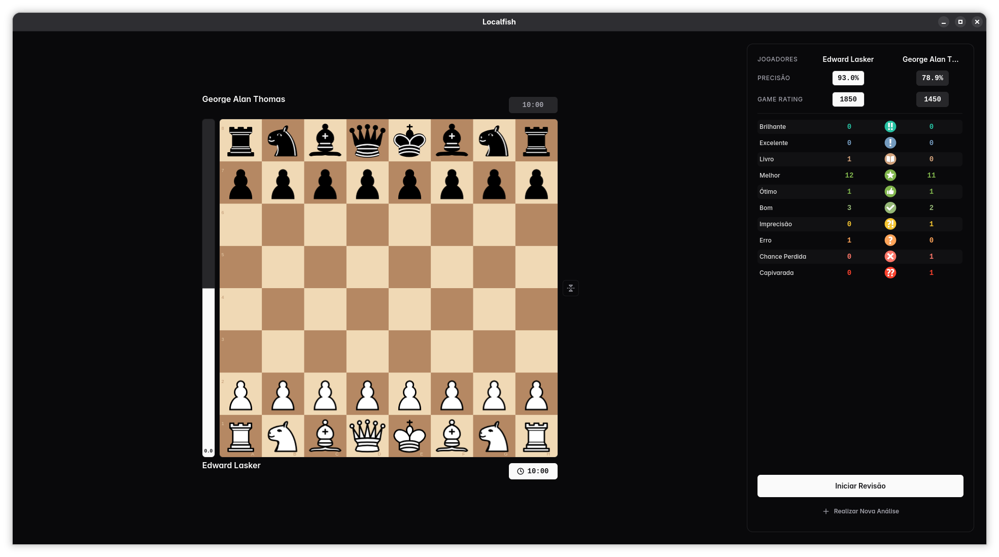
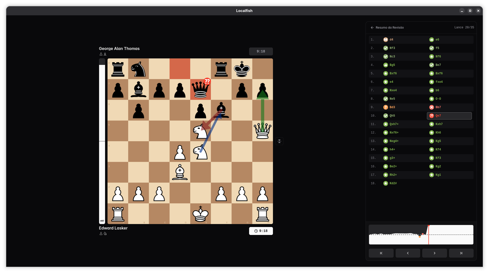

# Localfish ♟️🐟

Desktop application built with Electron for importing, viewing, and reviewing chess games with local **Stockfish** engine analysis.





## Getting Started

### Prerequisites

- [Node.js](https://nodejs.org/) (version 20 or higher recommended)
- `npm` package manager (or `pnpm` / `yarn`)

### Step by Step

1. **Clone the repository:**

   ```bash
   git clone https://github.com/antoniopedro/localfish.git
   cd localfish
   ```

2. **Install dependencies:**

   ```bash
   npm install
   ```

3. **Start in development mode:**

   ```bash
   npm run dev
   ```

> [!NOTE]
> Running `npm run dev` automatically downloads the Stockfish binary if it has not been downloaded yet.

## Core Libraries and Licenses

This project integrates foundational libraries from the open-source chess ecosystem:

| Library                                                          | Role in the Project                                                                                                                   | Official License                                                                           |
| ---------------------------------------------------------------- | ------------------------------------------------------------------------------------------------------------------------------------- | ------------------------------------------------------------------------------------------ |
| **[Stockfish](https://github.com/official-stockfish/Stockfish)** | Chess engine executed locally in a separate process for positional evaluation and calculation of the best tactical lines.             | [GPL-3.0 License](https://github.com/official-stockfish/Stockfish/blob/master/Copying.txt) |
| **[Chessground](https://github.com/lichess-org/chessground)**    | Interactive chessboard library developed by Lichess, responsible for the visual interface, smooth animations, and piece movement.     | [GPL-3.0-or-later License](https://github.com/lichess-org/chessground/blob/master/LICENSE) |
| **[chess.js](https://github.com/jhlywa/chess.js)**               | JavaScript library for chess rule validation, legal move generation, check/checkmate/draw detection, and FEN/PGN format manipulation. | [BSD-2-Clause License](https://github.com/jhlywa/chess.js/blob/master/LICENSE)             |

## License

This software is distributed under the **MIT** license. See the [LICENSE](./LICENSE) file for more details.
